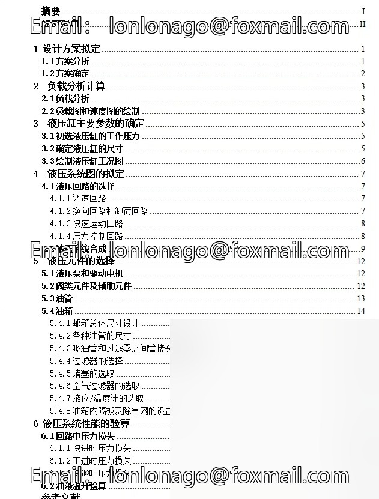
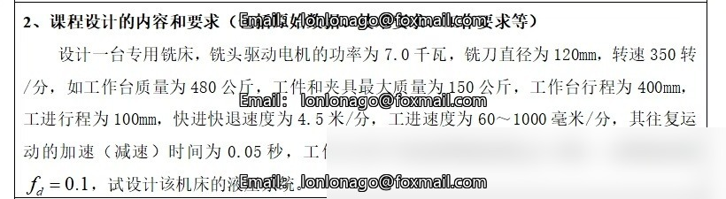
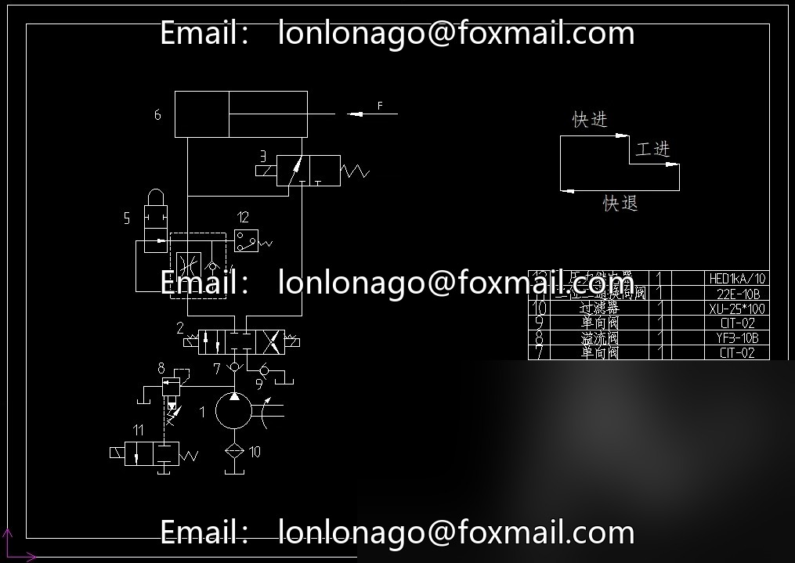
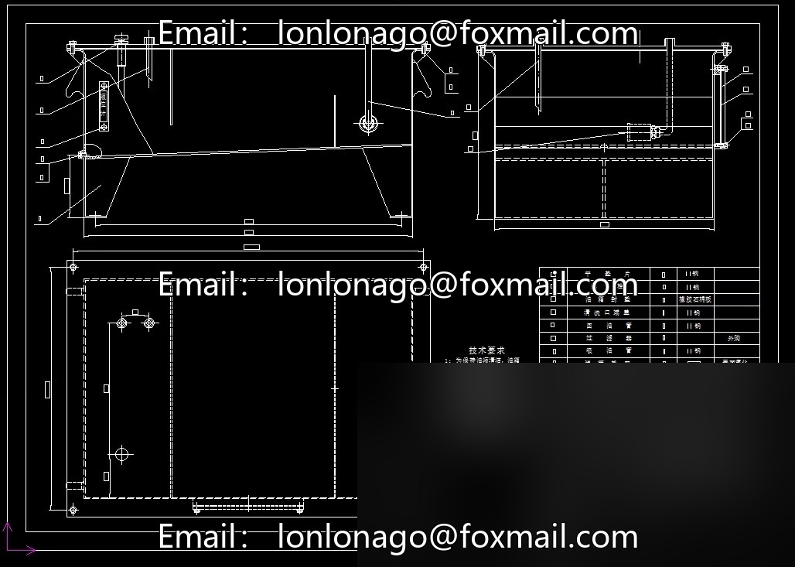

# Mill machine hydraulic system design; dedicated mill machine hydraulic system design; dedicated mill machine hydraulic system design

## Body

Milling machine hydraulic system design; special milling machine hydraulic system design; special milling machine hydraulic system design diagram; special milling machine hydraulic system design CAD diagram

The material includes design notes and CAD drawings, with system diagrams, hydraulic course design documents and detailed design content; specific design details should be referred to the attached figures.

<!-- AI_ENRICHED -->

## Images

## Payment

Here is a pay link on Stripe ( https://buy.stripe.com/3cs8yP7sY87d0vu9AB ). Please contact me lonlonago@foxmail.com after funding $89, and I will send you a complete data files , thank you!

